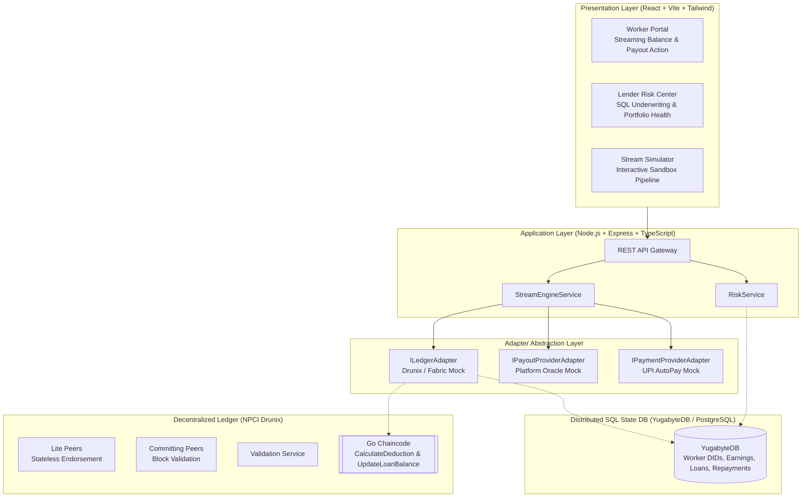

# 🏛️ MicroStream Architecture Specification

**Real-Time Micro-Credit Streaming for Gig Workers**  
*Powered by NPCI Drunix, YugabyteDB, and UPI AutoPay*

---

## 1. System Overview

MicroStream replaces rigid monthly Equated Monthly Installments (EMIs) with **proportional, real-time micro-credit streaming**. When a gig worker receives a daily platform payout (e.g. from Zomato, Swiggy, or Uber), the MicroStream smart contract calculates a micro-deduction (e.g. 5%) and triggers an automated UPI AutoPay debit under a pre-authorized variable e-mandate.

```
Daily Payout Credited ──> Payout Oracle ──> Drunix Chaincode ──> Variable UPI Debit ──> Ledger Settle
     (₹1,000)                                (5% = ₹50)            (AutoPay API)        (Balance = ₹9,950)
```

---

## 2. Core Components



### 2.1 NPCI Drunix Blockchain Network
- **Lite Peers:** Stateless nodes handling endorsement of high-frequency daily earnings and deduction micro-transactions.
- **Committing Peers:** Maintain the distributed ledger, validate block transactions, and commit state to the distributed SQL state database.
- **Validation Service:** Dedicated validation engine ensuring consensus rules and deterministic state updates.

### 2.2 YugabyteDB Distributed SQL State Database
- Replaces traditional Key-Value state databases (e.g. LevelDB/CouchDB) with **distributed SQL**.
- Allows lenders to execute complex risk-assessment queries (e.g. 60-day income moving averages and earnings standard deviation) **directly on ledger state without off-chain data pipelines**.

### 2.3 Go Smart Contract (Chaincode)
- **`LogDailyEarnings`**: Ingests earnings submitted by authenticated gig platforms. Deduplication key: `EARNINGS_REF_{did}_{date}_{ref}`.
- **`CalculateDeduction`**:
  $$\text{deduction} = \min(\text{payoutAmount} \times \text{deductionRate}, \text{outstandingBalance}, \text{dailyCap})$$
  Returns calculated deduction and a unique `idempotencyKey`.
- **`UpdateLoanBalance`**:
  Reduces outstanding balance on UPI callback, records a settled repayment, and closes loan when balance reaches zero.

### 2.4 UPI AutoPay Integration
- Operates under pre-authorized **variable e-mandates** with an approved cap (e.g. ₹2,000 max single debit).
- Frequency set to `AS_PRESENTED`.
- Every debit instruction carries a unique `idempotencyKey` preventing duplicate charges during network retries.

---

## 3. Financial Invariants: Strict Integer Paise Arithmetic

> ⚠️ **Rule:** Currency is NEVER represented as floating-point numbers in the core system.

- **1 INR = 100 paise**
- Storage: SQL `BIGINT`, Go `int64`, TypeScript `number` (with integer validation).
- Example:
  - Loan Principal ₹10,000.00 $\rightarrow$ `1000000` paise
  - Payout ₹1,400.00 $\rightarrow$ `140000` paise
  - Deduction (5%) $\rightarrow$ `7000` paise (₹70.00)
  - Remaining Balance $\rightarrow$ `993000` paise (₹9,930.00)

---

## 4. Separation of Live vs. Mock Integrations

To ensure safety and zero risk of unintended banking operations during development and hackathon evaluations:

| Component | Default Mode | Behavior | Safety Guarantee |
|---|---|---|---|
| **UPI AutoPay** | `Mock` | In-memory simulated execution via `MockUPIAutoPayAdapter` | Never executes real bank debits. Returns valid simulated NPCI transaction IDs. |
| **Payout Oracle** | `Mock` | Triggerable via REST endpoint `/api/payouts/simulate` | Safely simulates Zomato, Swiggy, and Uber settlements. |
| **Drunix Ledger** | `Mock / Local` | In-memory `MockLedgerAdapter` backed by synthetic seed data | Executes identical contract logic to Go chaincode without requiring external cluster. |
