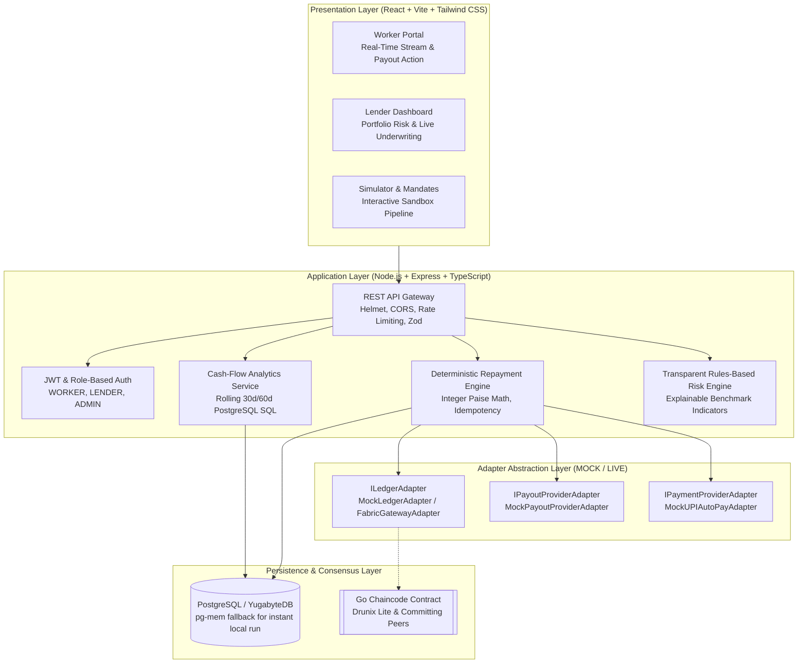

# 🏛️ MicroStream Architecture Specification

**Real-Time Micro-Credit Streaming for Gig Workers**  
*Powered by NPCI Drunix, PostgreSQL / YugabyteDB, and UPI AutoPay*

---

## 1. System Overview

MicroStream replaces rigid monthly Equated Monthly Installments (EMIs) with **proportional, real-time micro-credit streaming**. When a gig worker receives a daily platform payout (e.g. from Zomato, Swiggy, or Uber), the MicroStream deterministic repayment engine calculates an affordable micro-deduction (e.g. 5%) and triggers an automated UPI AutoPay debit under a pre-authorized variable e-mandate.

```
Daily Payout Credited ──> Payout Event ──> Deterministic Repayment Engine ──> Variable UPI Debit ──> Atomic Ledger Settle
     (₹1,000)                                     (5% = ₹50)                    (AutoPay API)          (Balance: ₹9,950)
```

---

## 2. Monorepo Architecture

The workspace is organized as a clean, decoupled monorepo:

```
MicroStream/
├── shared/            # TypeScript interfaces, monetary math, and deduction algorithms
├── backend/           # Node.js/Express TypeScript API, PostgreSQL data layer, adapter layer
├── frontend/          # React 18, Vite, TypeScript, Tailwind CSS, Recharts dashboard
├── chaincode/         # Go smart contracts for Hyperledger Fabric / NPCI Drunix
├── database/          # PostgreSQL & YugabyteDB schema DDL and synthetic seed records
├── infrastructure/    # Multi-stage Dockerfiles and Docker Compose configuration
├── scripts/           # Development reset and operational tooling
└── docs/              # Comprehensive architectural, API, and setup documentation
```

---

## 3. Component Interaction & Data Flow



---

## 4. Financial Invariants: Strict Integer Paise Arithmetic

> ⚠️ **Rule:** Currency is NEVER represented as floating-point numbers in the core system.

- **1 INR = 100 paise**
- Storage: SQL `BIGINT`, Go `int64`, TypeScript `number` (with integer validation).
- Standard Basis Points: `500 bps = 5.00%`.
- Deterministic Deduction Formula:
  $$\text{deductionPaise} = \min\left( \left\lfloor \frac{\text{payoutPaise} \times \text{rateBasisPoints}}{10000} \right\rfloor, \text{outstandingBalancePaise}, \text{remainingDailyCapPaise} \right)$$
- If $\text{deductionPaise} < \text{minimumThresholdPaise}$ (default: 100 paise = ₹1.00), deduction is clamped to zero.

---

## 5. Cash-Flow Analytics & Explainable Rules Engine

### 5.1 Rolling Windows & Data Quality Distinction
- **Window Options**: Rolling 30-day and 60-day periods.
- **Data Quality Categorization**:
  - `ACTIVE_EARNING`: Days with gross earnings $> 0$.
  - `ZERO_INCOME`: Genuine recorded days where the worker logged in but earned zero (e.g., zero order dispatch).
  - `MISSING_DATA`: Days where no platform settlement record exists.
  $$\text{activeDays} + \text{zeroIncomeDays} + \text{missingDays} = \text{windowDays}$$

### 5.2 Metrics Calculated via PostgreSQL-Compatible SQL
1. **Average Daily Earnings**: Mean gross earnings across active earning days vs across all calendar days.
2. **Median Daily Earnings**: Midpoint value resistant to extreme outlier spikes.
3. **Earnings Volatility**: Sample standard deviation ($\sigma$) and Coefficient of Variation ($CV = \sigma / \mu$) with automated tiers (`LOW`, `MODERATE`, `HIGH`).
4. **Number of Active Days**: Exact count of revenue-generating days.
5. **Payout Frequency**: Average interval between settlement payouts.
6. **Recent Earnings Trend**: Percentage change and slope comparing second half of the rolling period to the first half.
7. **Outstanding Loan Balance**: Principal plus interest remaining across active facilities.
8. **Repayment-to-Earnings Ratio**: Total debt service deductions as a percentage of gross income.
9. **AutoPay Debit Reliability**: Success percentage on first-attempt variable debits.

### 5.3 Transparent Rules-Based Assessment
- **Zero Black-Box AI**: Eliminates opaque machine learning models and credit score algorithms.
- **Zero Sensitive Personal Attributes**: Excludes age, gender, race, religion, and personal demographic data.
- **Explainable Indicators**:
  - *Volatility ($CV$)*: Low ($\le 0.30$), Moderate ($0.31 - 0.55$), High ($> 0.55$).
  - *Income Momentum*: Rising ($> +5\%$), Stable ($-5\%$ to $+5\%$), Falling ($< -5\%$).
  - *AutoPay Reliability*: Excellent ($\ge 90\%$), Moderate ($75 - 89\%$), Caution ($< 75\%$).
  - *Debt Burden*: Healthy ($\le 10\%$), Moderate ($10.1 - 20\%$), Stressed ($> 20\%$).
  - *Data Completeness*: Good ($\ge 80\%$), Moderate ($60 - 79\%$), Low ($< 60\%$).
- **Insufficient Data Guardrail**: If active days $< 10$, status is set to `INSUFFICIENT_DATA`, deferring underwriting or recommending a starter tier (₹2,000 max).
- **Regulatory Disclaimers**: Discloses sample size, data window, and explicitly states that scores do not guarantee creditworthiness or default prediction.

---

## 6. Privacy & Security Architecture

1. **Pseudonymous Worker Identifiers**:
   - Primary identifiers for lenders use SHA-256 derived pseudonyms (e.g., `ZOM-WRK-DE9E`, `SWI-WRK-B959`).
   - PII such as phone numbers are masked (`+91 ****** 43210`) and real legal names are redacted from risk queries.
2. **Mandatory Consent Verification Gate**:
   - Every risk evaluation query validates an active, unrevoked, unexpired consent grant for `EARNINGS_READ` or `CREDIT_ASSESSMENT`.
   - Access to unconsented records triggers HTTP 403 `CONSENT_REQUIRED`.
3. **Data Isolation**:
   - Authenticated workers (`/api/workers/me/*`) only access records linked to their own validated session token. Client-submitted IDs are rejected in favor of verified claims.
4. **Defense in Depth**:
   - Helmet for secure HTTP headers (X-Frame-Options, X-Content-Type-Options, etc.).
   - Express rate limiters for auth and global endpoints.
   - Zod request body validation.
   - Parameterized SQL queries preventing SQL injection.
   - Zero sensitive tokens or credentials in logs.
